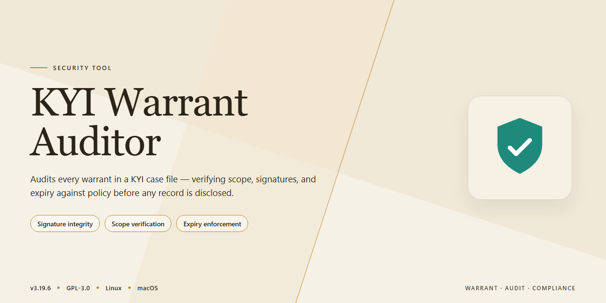

# KYI Warrant Auditor — Security Tool

### 💻 PowerShell Installer

   

---

KYI Warrant Auditor is a local verification tool for KYI warrant that checks signatures, inclusion proofs, and batch anchoring. It confirms whether a 's verdict and amount were altered after signing, treating both ALLOW and DENY outcomes as valid signed records. Verification requires only the JSON and Warrant's public key, so signature checks offline an API key or account. The tool audits authenticity and does not re policy evaluation.

## ✅ Before You Start

- Windows 10 or Windows 11
- PowerShell 5.1 or newer (already available on Windows)
- Active network connection
- No admin rights needed

## Features

**Cryptographic verification:** Validates each 's signature against the published public key, confirming that the signed body — including verdict, amount, and reasons — has not been altered after issuance.
- ** inclusion proofs:** Recomputes the 's leaf hash and checks the supplied proof path against the published batch root, detecting tampering or misattribution within a batch.
- ** anchoring checks:** Optionally queries the target chain's `ReceiptLog` contract to confirm that the batch root containing the is anchored.
- **Tamper demonstration mode:** A built-in tamper toggle mutates the body before verification so operators can observe a forged amount or verdict failing signature validation.
- **Verdict-agnostic auditing:** Both ALLOW and DENY are treated as first-class signed artifacts; a DENY that passes verification is reported as genuine, not as an error.
- **Offline-capable signature checks:** With the public key configured, signature verification network access or an API key; checks require only a public RPC endpoint.
- **Dual interface:** A browser-based auditor UI (or upload JSON, preview the card,, optionally tamper) and a headless CLI for scripted or CI-driven verification.
- **Fixed-order canonicalization:** bodies are canonicalized with a deterministic field order before hashing and signature checks, eliminating serialization ambiguity from the verification path.
- **Local-only execution:** All verification logic on the operator's machine; data and public keys are not transmitted to as part of the audit.
- **Minimal input surface:** Auditing requires only the JSON and the current Warrant public key — no account provisioning, credentials, or private key material.
- **Scope clarity:** The auditor attests to authenticity and integrity; it does not re-evaluate the policy decision that produced the verdict, and reports this boundary explicitly.

## How it works

The auditor operates as a self-contained verification pipeline. It accepts a warrant as input, reconstructs the signed payload, and validates it against the issuer's published public key. No outbound call is needed for the core cryptographic check.

**Verification pipeline**

1. **Input capture** — the JSON is pasted into the UI or loaded from a local file. The tool parses and normalizes the document before any check.
2. **Payload reconstruction** — the body is isolated, with transport or anchor metadata excluded, and canonicalized into a deterministic serialization. Field order is fixed so that semantically identical always produce identical bytes.
3. **Signature validation** — the detached signature is verified against the issuer's public key, using the key identifier embedded in the to select the correct key. A single altered byte in the payload causes this step to fail.
4. ** inclusion** — where a proof is present, the 's leaf hash is walked up the proof path and compared to the published batch root. A mismatch indicates the is not part of the claimed batch.
5. **Anchor check** — optionally, the batch root is queried against the log to confirm the batch was anchored. This step requires only a public RPC endpoint; no issuer account or credential is involved.

A **DENY** verdict that passes all checks is still an authentic. The auditor reports authenticity, not approval — a signed denial is a valid signed denial.

**What the tool needs**

- The JSON, obtained from the agent, merchant, or an export
- The issuer's public key, which is shared across all signed under the current key and rotates only at key rollover

No issuer API key is required for signature or verification. The public key is public by design; auditors are expected to hold it. When it is configured, signature checks proceed fully offline.

**Tamper demonstration**

The UI and the headless verifier both expose a tamper mode that deliberately modifies the signed amount before verification, so an operator can observe a forged being rejected. This is a demonstration path only and does not alter the underlying verification logic.

**Scope**

The auditor establishes that a is authentic and unmodified, that it belongs to a published batch, and — when enabled — that the batch is anchored. It does not re-execute the policy that produced the verdict, and it does not evaluate whether the verdict was correct. Those are separate concerns outside the tool's trust boundary.

## Privacy

KYI Warrant Auditor is designed to operate entirely within the auditor's own environment. It does not transmit data, public keys, or verification results to any remote service operated by the project. All cryptographic verification — signature checks and proof validation — in the process that executes the tool.

**Data handling**

- The tool reads only the inputs you supply: a JSON file or pasted payload, and a public key (via environment configuration or a local key file). Nothing outside these inputs is read from your filesystem.
- contents are held in memory for the duration of verification and are not persisted unless you explicitly save or export them.
- No telemetry, analytics, crash reporting, or usage logging is built into the tool. The codebase contains no outbound calls to project-owned endpoints.

**Network activity**

- Signature and checks are fully offline. Once a public key is configured, no network access is required for these steps.
- anchor checks (batch presence in ReceiptLog) are optional and, when enabled, query a public RPC endpoint that you configure yourself. In that mode the RPC provider can observe the batch identifier being queried, so treat RPC selection as part of your operational security posture.
- No API keys for the Warrant issuing service are required or requested for the cryptographic verification path.

**Secrets and sensitive material**

- Only public keys belong in this tool. Never place private signing keys, service credentials, or API secrets in configuration files consumed by the auditor.
- Because may contain merchant, agent, or transaction metadata, treat files as sensitive artifacts: scrub or redact them before sharing in issues, pull requests, or bug reports.

**Verification scope**

The auditor attests to the authenticity and integrity of a as signed — it does not re-execute policy, does not contact the issuer on your behalf, and does not assert anything beyond what the provided public key and, optionally, the configured chain can prove. Trust in the outcome ultimately rests on the integrity of the public key you supply and the RPC endpoint you choose.

## FAQ

**Does verification require network access?**
No for signature and checks. The signature and inclusion proof are validated offline against the bundled public key and the 's own leaf data. Only the optional anchor lookup requires a public RPC endpoint. You can the full crypto audit with no network connection at all.

**Is the public key sensitive?**
No. The public key is public by design — auditors are expected to hold it. It is used solely to confirm that a was signed by the current Warrant key. Private keys never belong in this tool; only the public key should ever be present in configuration or on disk.

**Does a DENY verdict mean the is invalid?**
No. Both ALLOW and DENY are legitimately signed outcomes. A DENY that passes signature and verification is an authentic recording a real decision. Verification answers "was this issued by Warrant and left unmodified," not "was the underlying decision correct."

**What exactly does a passing verification prove?**
Three things, in order: the body was signed by Warrant's current key (amount, verdict, and reasons were not altered after signing); the is included in the published batch tree; and, when enabled, that batch is anchored in the ReceiptLog. Any post-signing edit to the signed fields causes signature verification to fail.

**Why does tampering always fail?**
The signature is computed over the canonicalized body with fields ordered deterministically and the `onchain` field excluded. Changing any signed field — amount, verdict, reasons — produces a different canonical form, so the signature no longer matches. The included tamper mode demonstrates this by mutating the amount and surfacing the failure.

**Does this tool re policy or re-evaluate the decision?**
No. The auditor confirms authenticity and integrity of a only. It does not replay policy logic, re-execute the decision engine, or validate that the recorded verdict was the correct one. Treat it as a cryptographic provenance check, not a policy oracle.

**What inputs are needed to audit a?**
The JSON (exported from the agent, merchant, or record store) and Warrant's public key for the relevant key rotation period. No vendor API key or account is required for the crypto checks. The key identifier embedded in the signature indicates which key generation signed the.

**Does key rotation break older?**
Each carries a `signature.key_id` identifying the key that signed it. signed under a prior key must be verified against that key's public material. Confirm the key identifier before verifying, and retain historical public keys for as long as you need to audit from that period.

**Can I in an automated pipeline?**
Yes. A headless CLI path accepts a file and returns a pass/fail result suitable for CI or batch jobs, with an optional tamper flag for negative testing. The local API exposes the same verification pipeline for programmatic callers. No browser is required.

**Is any data transmitted externally?**
Crypto verification is local. contents stay on the machine performing the audit, and the public key check offline. If confirmation is enabled, only the batch reference needed for the lookup is queried against a public RPC — fields are not forwarded as part of that check.

**What are the trust assumptions?**
You trust the bundled public key corresponds to Warrant's signing key, and you trust the public RPC's response if checking is enabled. Everything else — canonicalization, signature verification, proof — is computed by open code you can inspect and yourself.

## Disclaimer

This tool performs cryptographic verification of KYI Warrant using the signature scheme, inclusion proofs, and optional anchoring checks. Verification results are deterministic given the same input data, public key, and chain state at query time.

The auditor validates that a was signed by the holder of the corresponding private key and that the contents have not been altered after signing. It does not evaluate whether the underlying policy decision was correct, whether the transaction it describes was legitimate, or whether the issuing party acted in good faith. A that passes verification attests only to authenticity and integrity — not to intent, legality, or fitness for any purpose.

Users are responsible for confirming that the public key used during verification is the authentic key of the party they intend to audit. A verified against an incorrect or substituted public key may produce misleading results. Likewise, checks depend on the correctness and availability of the queried network endpoint; the tool does not independently validate network responses beyond the checks described in the verification pipeline.

This software is provided for audit and inspection purposes. It should not be the sole basis for financial, legal, or security decisions. Output from the tool — including ALLOW and DENY verdicts, tamper indicators, and chain-status messages — reflects only the outcome of the defined verification steps and carries no implied endorsement, warranty, or certification by the project maintainers.

The software is distributed under the MIT License and is provided "as is," warranty of any kind, express or implied, including but not limited to the warranties of merchantability, fitness for a particular purpose, and noninfringement. In no event shall the authors or copyright holders be liable for any claim, damages, or other liability arising from, out of, or in connection with the software or its use.

No private keys should ever be supplied to this tool. Only public keys are required and expected. Handling of containing sensitive or personal data is the sole responsibility of the operator; the tool performs verification and does not transmit contents beyond what is necessary for optional queries.

## License

KYI Warrant Auditor is released under the MIT License.

Copyright (c) KYI Warrant Auditor contributors

Permission is hereby granted, free of charge, to any person obtaining a copy of this software and associated documentation files (the "Software"), to deal in the Software restriction, including limitation the rights to use, copy, modify, merge, publish, distribute, sublicense, and/or sell copies of the Software, and to permit persons to whom the Software is furnished to do so, subject to the following conditions:

The above copyright notice and this permission notice shall be included in all copies or substantial portions of the Software.

THE SOFTWARE IS PROVIDED "AS IS", WARRANTY OF ANY KIND, EXPRESS OR IMPLIED, INCLUDING BUT NOT LIMITED TO THE WARRANTIES OF MERCHANTABILITY, FITNESS FOR A PARTICULAR PURPOSE AND NONINFRINGEMENT. IN NO EVENT SHALL THE AUTHORS OR COPYRIGHT HOLDERS BE LIABLE FOR ANY CLAIM, DAMAGES OR OTHER LIABILITY, WHETHER IN AN ACTION OF CONTRACT, TORT OR OTHERWISE, ARISING FROM, OUT OF OR IN CONNECTION WITH THE SOFTWARE OR THE USE OR OTHER DEALINGS IN THE SOFTWARE.

The MIT License applies uniformly to the verification pipeline, the local API, the command-line interface, and the browser-based auditor UI contained in this project. No separate licensing terms apply to individual components.

The Warrant public key bundled with this project is public by design and is distributed under the same MIT terms. It carries no confidentiality obligation and may be redistributed freely alongside the Software.

Verification results produced by KYI Warrant Auditor are outputs of the Software and are not themselves subject to the copyright notice above. You may store, transmit, and publish verification results restriction.

This license does not grant any rights to the Warrant private keys, to any service, or to third-party trademarks. Use of the Software does not create any relationship with, or obligation from, the maintainers beyond the terms stated here.

Redistributions of modified versions must retain the copyright notice and this permission notice. If you distribute a modified build, do not represent it as the official KYI Warrant Auditor release.